# 🚗 What Is a Used Car Really Worth in Sri Lanka?
### Explainable used-car price prediction from 2026 Riyasewana.com adverts

[](https://www.python.org/)
[](https://streamlit.io/)
[](https://scikit-learn.org/)
[](https://catboost.ai/)
[](https://shap.readthedocs.io/)
[](#-results)
[](https://sl-car-price-estimator-bjruz8rzidloyow7ikhuve.streamlit.app/)

**Melanie Samaratunga** · 269188K · MSc in Artificial Intelligence, University of Moratuwa · *Applied Machine Learning: Final Assignment*

> 🔗 **Live app:** [sl-car-price-estimator.streamlit.app](https://sl-car-price-estimator-bjruz8rzidloyow7ikhuve.streamlit.app/) &nbsp;·&nbsp; 📂 **Repo:** [meluom/sl-car-price-estimator](https://github.com/meluom/sl-car-price-estimator)

Sri Lanka reopened vehicle imports in 2025, and buyers and sellers still have no reliable reference price; most people scroll through dozens of adverts and guess. This project cleans **6,436 real Riyasewana.com adverts (May – August 2026)** and compares **7 tuned models against 2 baselines** using a leakage-safe evaluation. It deploys an explainable **CatBoost** model that estimates a car's fair asking price, with a **median error of 5.5%**, and explains every estimate with SHAP.

---

## 📌 Table of Contents
- [Highlights](#-highlights)
- [Pipeline](#%EF%B8%8F-pipeline)
- [Dataset](#-dataset)
- [Data Quality Audit](#-data-quality-audit)
- [Exploratory Analysis](#-exploratory-analysis)
- [Results](#-results)
- [Explainability: SHAP & LIME](#-explainability-shap--lime)
- [Streamlit App](#%EF%B8%8F-streamlit-app)
- [Repository Structure](#-repository-structure)
- [Run It Yourself](#%EF%B8%8F-run-it-yourself)
- [Limitations & Roadmap](#%EF%B8%8F-limitations--roadmap)
- [Acknowledgements](#-acknowledgements)

---

## ✨ Highlights

| | |
|---|---|
| 🎯 **Accurate** | Test R² **0.929** on 997 unseen cars · median error **5.5%** · **91%** of cars within ±20% |
| 🧹 **Audited data** | 10 documented cleaning rules, each logging its row count (`reports/cleaning_audit.json`) |
| 🔒 **Leakage-safe** | Re-posted adverts grouped, so a car never appears in both train and test |
| ⚖️ **Fair comparison** | 5-fold GroupKFold CV · every model tuned · model chosen on CV, **not** on the test set |
| 🔍 **Explainable** | Global + local SHAP, LIME cross-check, and a live SHAP waterfall in the app |
| 💡 **Real finding** | Mileage only matters up to **~100,000 km**; location has almost no effect |

> **Honest metrics only.** Errors are reported in rupees and percent. Log-scale "accuracy" figures like "99%" are avoided, because they make weak models look near-perfect.

---

## 🏗️ Pipeline

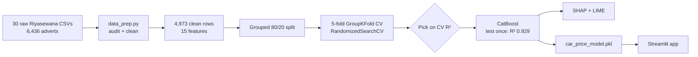

---

## 📂 Dataset

| | |
|---|---|
| **Source** | Riyasewana.com car adverts, scraped by S. Savindu ([repo](https://github.com/savindu777/Sri-Lanka-Car-Market-Anlaysis-2026), MIT licence per its README) |
| **Period** | 13 May – 16 August 2026 |
| **Size** | 6,436 raw adverts → 4,973 clean rows |
| **Coverage** | 11 brands · 84 model families (~30 popular) · 107 towns |
| **Target** | Asking price in rupees (modelled as log price) |

**Features used (15):** Brand · Model family · Age · Mileage · Engine cc · Cylinders · Gear · Fuel · Body type · Condition (registered used / reconditioned / brand new) · Country of manufacture · Location · Power steering · Power shutters · Power mirrors

<details>
<summary><b>Why not the popular Kaggle Sri Lankan car dataset?</b></summary>

| Criterion | Kaggle dataset | Riyasewana 2026 (used) |
|---|---|---|
| Mileage | ❌ Synthetic: `(2025 − year) × 11,000 km` for every row | ✅ Real odometer readings |
| Price unit | ❓ Undocumented | ✅ Rupees |
| Period | Dec 2024 – Feb 2025 | May – Aug 2026 |

</details>

<details>
<summary><b>Why the 30 raw files and not <code>combined_datasets.csv</code>?</b></summary>

Both contain the same 6,436 adverts. Each raw file name identifies its model (for example, `riyasewana_toyota_aqua_…csv`), which gives a clean **model family** feature. The combined file loses that, leaving 900+ free-text model spellings.

</details>

---

## 🧹 Data Quality Audit

| Problem found | Rows | Action |
|---|---:|---|
| Price says "Negotiable" | 1,440 | Removed: no target |
| Duplicate column headers (Power Mirror / Mirrors) | 218 | Merged |
| Engine cc typos (1, 18, 15,000, 149,000) | 69 | Rescaled to 600–7,000 cc |
| Deposits or lease instalments posted as price (< Rs 300k) | 3 | Removed |
| Price > 4× away from similar cars (typos) | 13 | Removed |
| Used car > 2 years old with < 1,000 km | 45 | Mileage set missing → imputed |
| Antique cars | 6 | Removed |
| Re-posted adverts | 85 | Kept, grouped in the split |

<p align="center">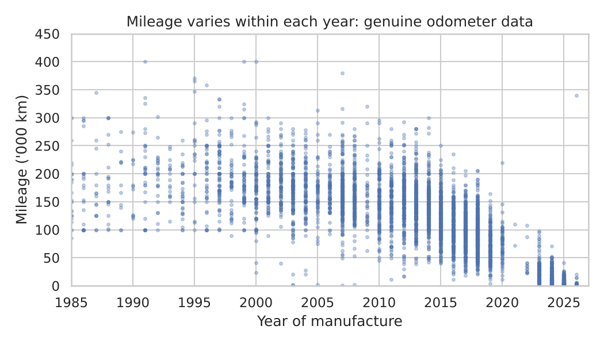</p>

---

## 📈 Exploratory Analysis

<p align="center">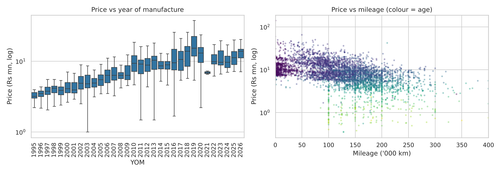</p>
<p align="center">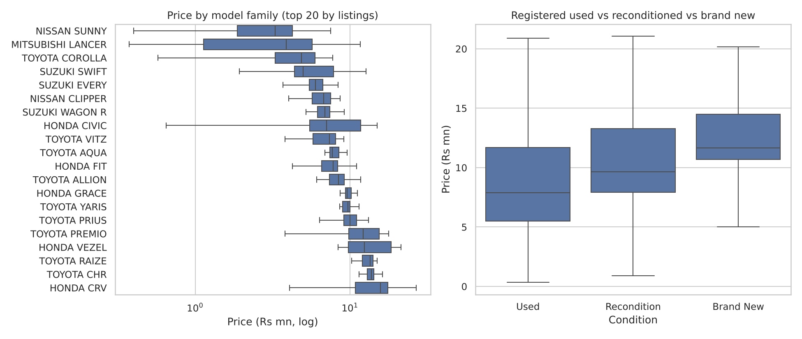</p>

- Price falls steadily with **age**, and is heavily right-skewed (Rs 0.35M – 140M), so the model learns **log price**.
- Young cars have low mileage, so the model must separate **age** from **mileage**.
- Raw comparisons mislead: diesel looks most expensive only because the diesels are mostly German luxury cars.

---

## 🏆 Results

| Model | CV R² (mean ± sd) | Test R² | MAE (Rs M) | MAPE |
|---|---|---:|---:|---:|
| 🥇 **CatBoost (deployed)** | **0.885 ± 0.050** | **0.929** | **0.85** | **8.9%** |
| XGBoost | 0.883 ± 0.074 | 0.932 | 0.80 | 8.8% |
| LightGBM | 0.880 ± 0.081 | 0.940 | 0.79 | 8.8% |
| Random Forest (tuned) | 0.865 ± 0.101 | 0.937 | 0.76 | 8.5% |
| Random Forest (default) | 0.860 ± 0.106 | 0.934 | 0.79 | 8.9% |
| Stacking (RF + XGB + LGBM) | 0.827 ± 0.067 | 0.912 | 1.13 | 12.1% |
| Ridge (linear) | 0.776 ± 0.057 | 0.825 | 1.41 | 14.2% |
| Baseline: "compare similar ads" | – | 0.848 | 1.00 | 13.7% |
| Baseline: global median | – | −0.054 | 4.38 | 73.8% |

<p align="center">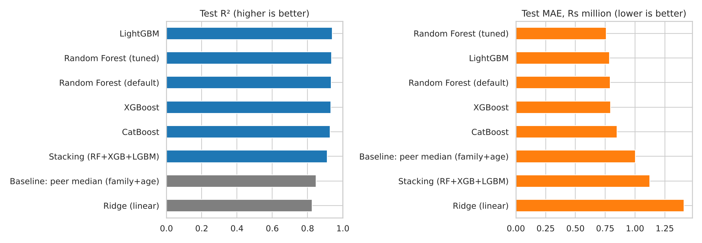</p>

**Why CatBoost?** It had the highest and **most stable** cross-validation score (sd 0.050, against 0.074–0.101 for the others), it handles brand, model and town natively, and it produces exact TreeSHAP explanations from a 0.3 MB model. LightGBM scored slightly higher on test, but the choice was made on CV, because picking by test score would make the reported result optimistic.

<p align="center">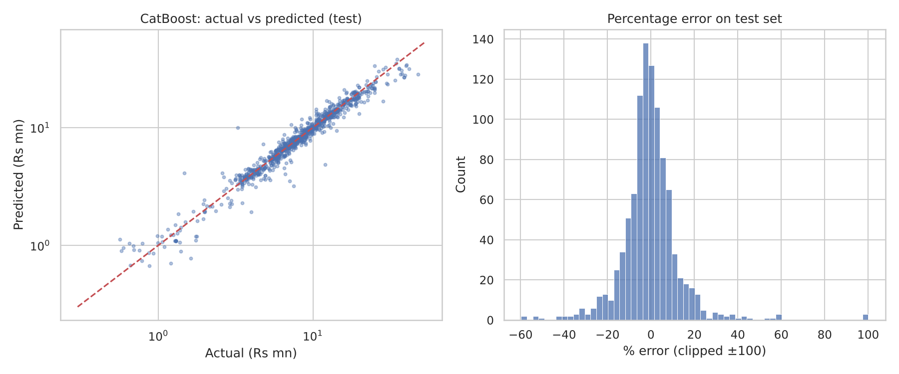</p>

---

## 🔍 Explainability: SHAP & LIME

<p align="center">
  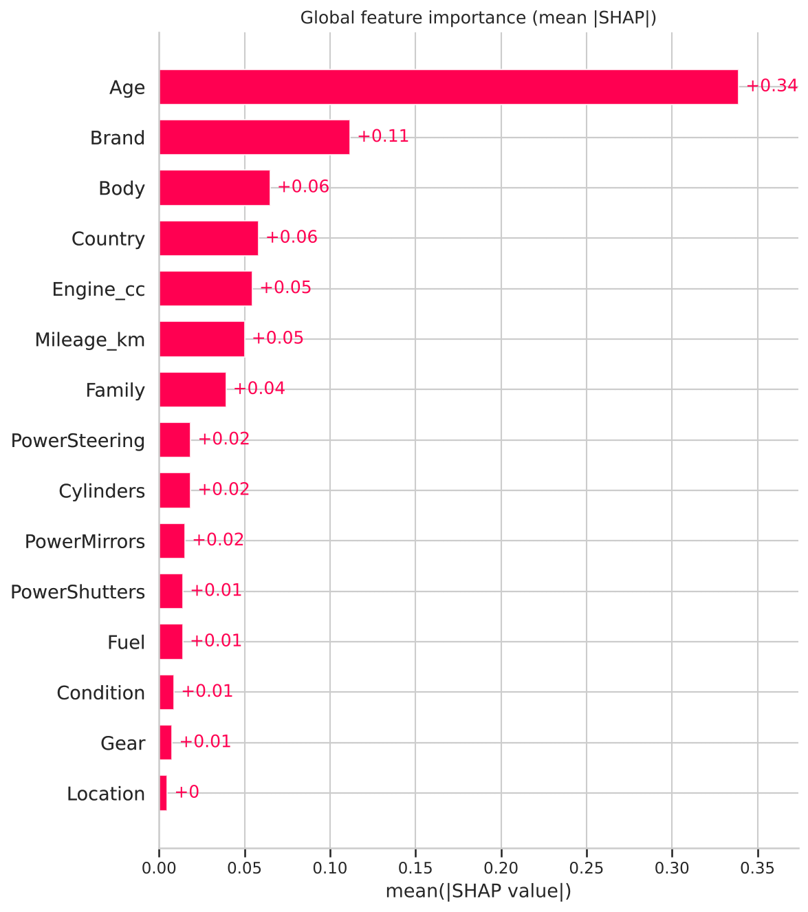
  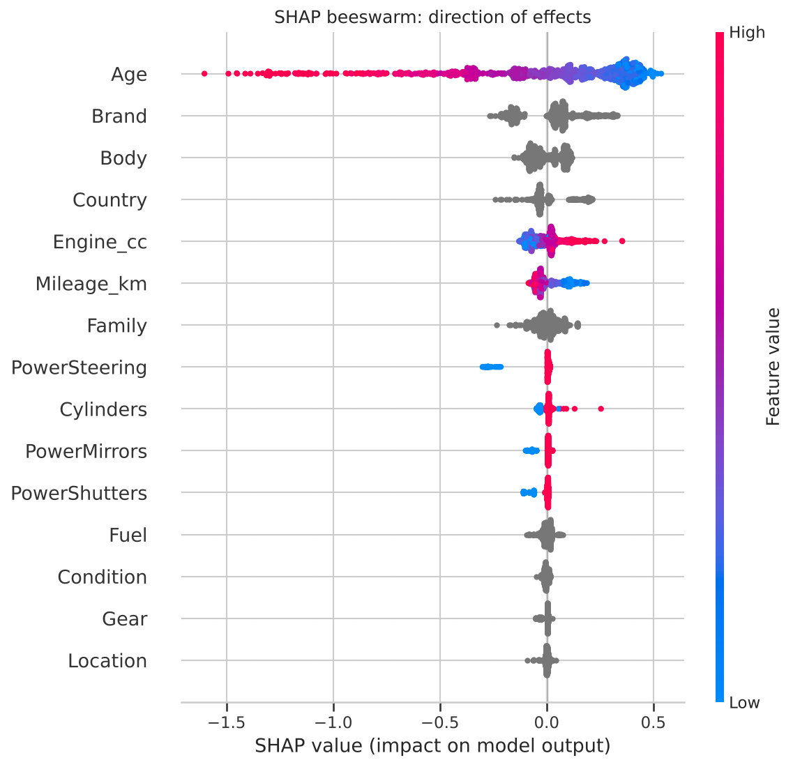
</p>

<p align="center">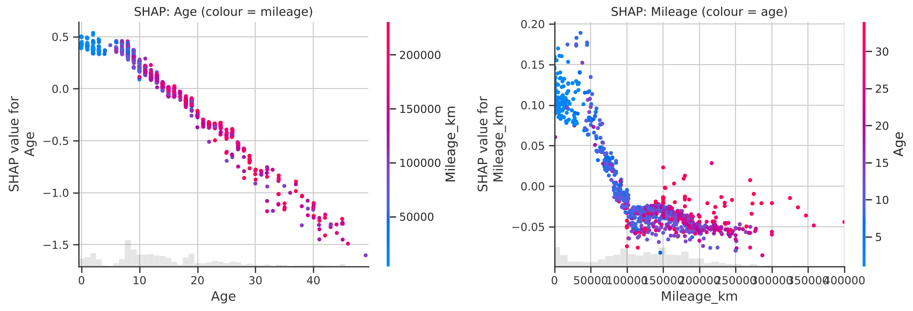</p>

- **Age** dominates, costing about 4–5% of value per year.
- **Mileage only matters below ~100,000 km**, then the curve goes flat. A linear model cannot learn this.
- **Location ≈ 0**: a Colombo car is not priced higher than the same car elsewhere.

**SHAP vs LIME (one car, a 2002 Lancer):** both agree that age and brand pull the price down. LIME also credits the town with +0.22, an artefact of its random perturbation, so SHAP is the primary explanation and LIME the cross-check.

<p align="center">
  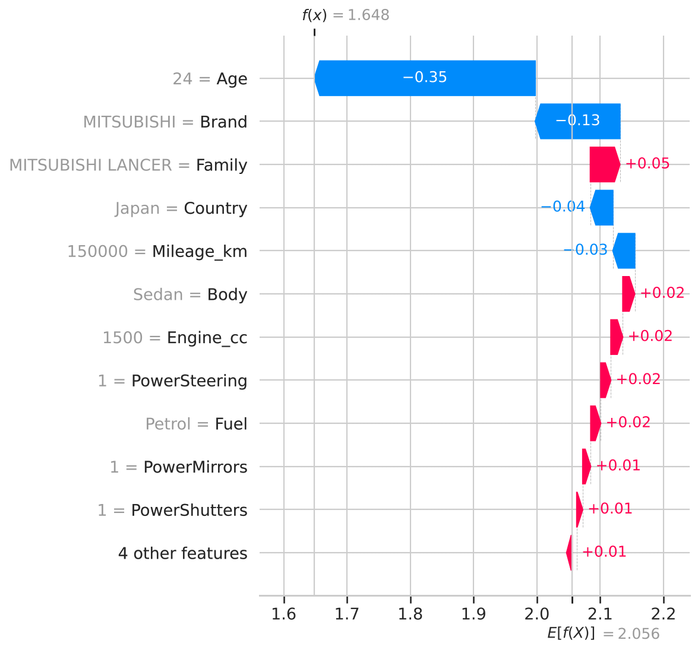
  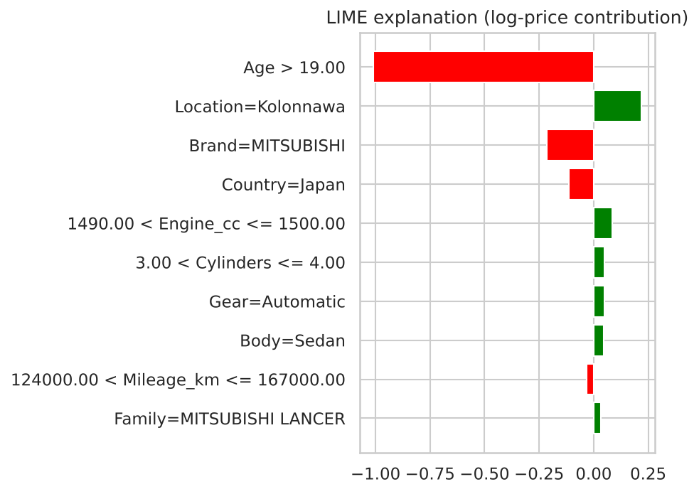
</p>

---

## 🖥️ Streamlit App

<p align="center">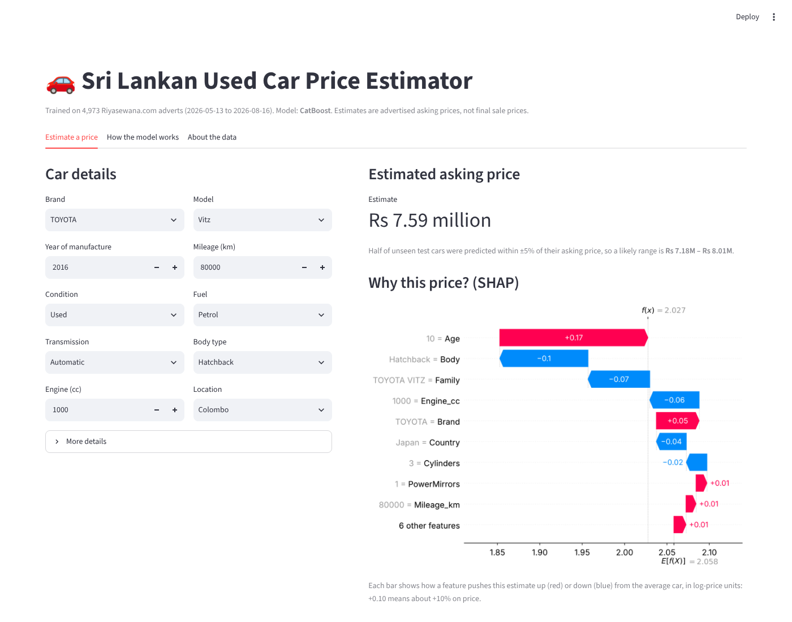</p>

- Pick a brand and model, and typical engine, fuel and body are pre-filled.
- You get an **estimate**, a **likely range**, and a **live SHAP waterfall** explaining why.
- A warning appears when the chosen model has few training adverts.
- Tabs for model comparison, SHAP/LIME charts and data notes.

---

## 📁 Repository Structure

```
├── app.py                           # Streamlit app: loads the pickle, predicts, explains
├── data_prep.py                     # Reusable cleaning pipeline with audit log
├── catboost_wrapper.py              # sklearn-compatible CatBoost wrapper (needed to unpickle)
├── car_price_riyasewana_2026.ipynb  # Full analysis: audit → EDA → models → SHAP/LIME → export
├── data/raw/                        # 30 raw Riyasewana CSV files
├── models/
│   ├── car_price_model.pkl          # Deployed CatBoost pipeline
│   ├── metadata.json                # Dropdown options, defaults, metrics
│   └── test_results.json
├── reports/
│   ├── figures/                     # All charts
│   ├── cleaning_audit.json          # Rows touched by each cleaning rule
│   ├── cv_results.csv
│   └── test_results.csv
└── requirements.txt                 # Pinned versions (must match the pickle)
```

---

## ⚙️ Run It Yourself

```bash
git clone https://github.com/meluom/sl-car-price-estimator.git
cd sl-car-price-estimator

python -m venv .venv
# Windows
.venv\Scripts\activate
# macOS / Linux
source .venv/bin/activate

pip install -r requirements.txt
streamlit run app.py
```

**Retrain:** open `car_price_riyasewana_2026.ipynb` and run all cells (about 6–10 minutes).
**New data:** drop freshly scraped CSVs with the same columns into `data/raw/` and re-run the notebook. `data_prep.py` applies the same rules.

**Deploy (Streamlit Community Cloud):** share.streamlit.io → **Create app** → choose this repo, branch `main` and `app.py` → **Advanced settings → Python 3.13** → **Deploy**.

---

## 🗺️ Limitations & Roadmap

**Limitations:**
- These are asking prices, not sale prices.
- 22% of ads ("Negotiable") were dropped.
- Covers ~30 popular models from 11 brands.
- Four months of data.
- Trim level and service history are not modelled.

**Roadmap:**
- [ ] Monthly re-scrape, retrain and drift monitoring (MLOps)
- [ ] Extract trim level ("G grade", "M Sport") from advert titles
- [ ] Quantile models for calibrated price ranges
- [ ] Extend to all brands and to ikman.lk

---

## 🙏 Acknowledgements

- **Data:** raw Riyasewana.com listings scraped by **S. Savindu**, [Sri-Lanka-Car-Market-Analysis-2026](https://github.com/savindu777/Sri-Lanka-Car-Market-Anlaysis-2026) (MIT licence, as stated in its README). Only the raw CSV files were reused; all cleaning, modelling, analysis and the app in this repository are original.
- **Methods:** SHAP (Lundberg & Lee, 2017) · LIME (Ribeiro et al., 2016) · CatBoost (Prokhorenkova et al., 2018) · XGBoost (Chen & Guestrin, 2016) · LightGBM (Ke et al., 2017) · scikit-learn (Pedregosa et al., 2011).

### Acknowledgement of AI Assistance
Claude (Anthropic) was used to assist with structuring the notebook, debugging code, and drafting this documentation. All code was reviewed, tested, and understood by the student before submission.

---

<p align="center"><b>Melanie Samaratunga</b> · MSc in Artificial Intelligence · University of Moratuwa · 2026</p>
